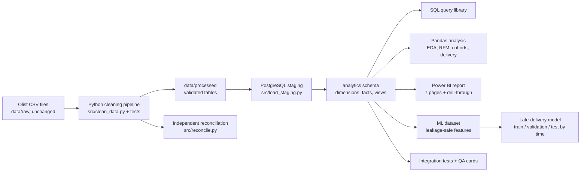

# Architecture

Layers: ingestion and cleaning (Python), storage and modelling (PostgreSQL), analysis (SQL, Pandas), presentation (Power BI), prediction (scikit-learn), assurance (pytest, reconciliation, QA cards).