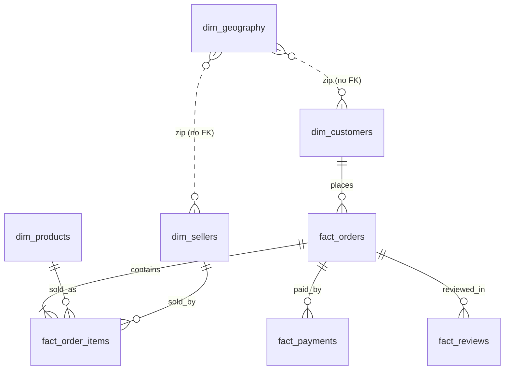

# Database Schema (PostgreSQL 17, database `olist`)

Two schemas: `staging` (12 tables, cleaned CSVs loaded as-is) and `analytics` (4 dimensions, 4 facts, 5 views). Built by `sql/01` to `sql/06`; loader: `src/load_staging.py`.

## ER diagram (analytics schema)

## Grain and keys

| Table | Grain | Primary key |
|---|---|---|
| dim_customers | one customer_id | customer_id |
| dim_products | one product | product_id |
| dim_sellers | one seller | seller_id |
| dim_geography | one zip prefix | zip_code_prefix |
| fact_orders | one order | order_id |
| fact_order_items | one item line | (order_id, order_item_id) |
| fact_payments | one payment line | (order_id, payment_sequential) |
| fact_reviews | one review row | (review_id, order_id) |

## Design notes
- No foreign key from customers or sellers to dim_geography: 278 customer rows and 7 seller rows have zips absent from geolocation (Module 1). Join with LEFT JOIN.
- fact_orders joins only tables already at one row per order, and the build script asserts the row count is unchanged.
- customer_unique_id identifies a person; customer_id is per order. Repeat-customer analysis uses customer_unique_id (view v_customer_orders).
- Money is NUMERIC; timestamps are TIMESTAMP without time zone (the dataset states none).

## Views (each states its grain)
v_monthly_sales (month), v_category_sales (category), v_seller_performance (seller), v_delivery_by_state (customer state), v_customer_orders (person). All sum revenue to 13,494,400.74.

## Analytical assumptions
- A1: Trend window is 2017-01 to 2018-08. Measured: 2016-09 has 4 orders, 2016-10 has 324, 2016-11 has none, 2016-12 has 1; 2018-09 has 16 and 2018-10 has 4. Cause of the sparse ends is not determined.
- A2: Revenue is the sum of item price for orders that are not canceled or unavailable (rule R18).
- A3: Q6 uses a 100-delivered-orders minimum per state (author's choice; all 24 states passed).